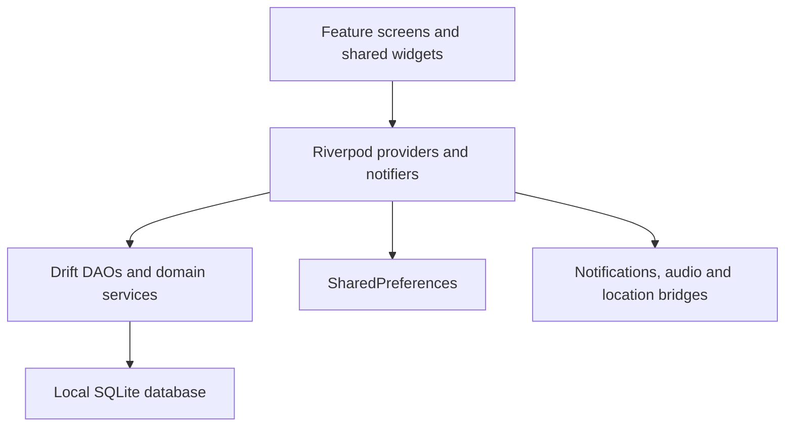

# Ascent application architecture

Current source reference · reviewed 12 October 2026. Release baseline: `1.0.9+10`; database schema 15. Proposed changes belong in the [planning documents](README.md), not in this description of current behavior.

## Application and navigation

`lib/main.dart` initializes the workspace and platform services. `lib/app/app.dart` binds themes and navigation; `lib/app/router.dart` owns GoRouter routes and the root navigator key. Splash leads to onboarding or Home using the local workspace-entry rules in settings. There is no account-login route or demo credential requirement.

The shell contains Home, Reminders, Money and More. Momentum/challenges and other tools have explicit routes outside those shell branches. The main scaffold owns the secondary-tab back behavior and Home's double-back exit guard. Pending notification destinations survive entry/onboarding through the notification service.

## State and storage

Most persistent records live in Drift tables under `lib/core/database/`; `app_database.dart` owns the schema and migrations. `app_database.g.dart` is required generated source. `database_provider.dart` exposes DAOs and reactive queries. Features also have domain services for operations involving multiple records or platform effects; there is no pass-through repository layer.

Learning course/module/lecture catalog and progress are currently persisted through the learning notifier's versioned preferences. Learning and Focus also record sessions in SQLite. Settings and recoverable note drafts use SharedPreferences. Do not describe every piece of state as exclusively database-backed.

`time_tracking_provider.dart`, `learning_hub_provider.dart`, walk tracking and challenge services own their respective lifecycle rules. `study_streak_provider.dart` handles study credit; legacy consistency and momentum tables still exist and must not be dropped merely because an old UI was replaced. Backup compatibility and persisted user records require explicit migrations.

## Riya

`core/ai/riya_capabilities.dart` defines typed supported operations and verified execution with persisted request receipts. `riya_intents.dart` resolves local conversational requests; the assistant screen owns chat presentation. Other AI helpers remain under `core/ai/`. A registry entry or a navigation action is not proof of unrestricted control over that feature. New actions must validate real record identities, preserve completion rules and report actual saved outcomes.

## Notifications and tracking

`core/notifications/` owns notification presentation, reminder reconciliation and platform alarm bridges. Android code under `android/app/src/main/kotlin/com/arun/ascent/` supplies native alarm and service behavior. Reminder database state and successful OS scheduling are separate outcomes. Edits/deletions/restores must reconcile native alerts through the existing lifecycle services.

Focus/Learning session controls and walk tracking have background lifecycle considerations. Keep timer authority and recovery independent of whether Home currently renders a preview.

## Backup and recovery

`core/backup/workspace_backup_service.dart` exports/restores database records, preferences and supported attachments. It validates input, creates a recovery copy and uses a durable restore journal. Restore compatibility, imported paused-session behavior and alert reconciliation are part of the data contract. Operating-system permissions and external media are not ordinary imported workspace records.

## Presentation and verification

`app/theme/` contains semantic color/glass tokens, dimensions, typography and theme builders. Active shared components are indexed in the [component catalog](COMPONENT_CATALOG.md). Feature-specific forms and sheets stay within their feature directories.

Validate source changes with `flutter analyze` and relevant tests. Changes to data lifecycles need database/recovery coverage; platform scheduling and background behavior require device evidence. Rendering targets are goals to measure, not guarantees inferred from the framework.
