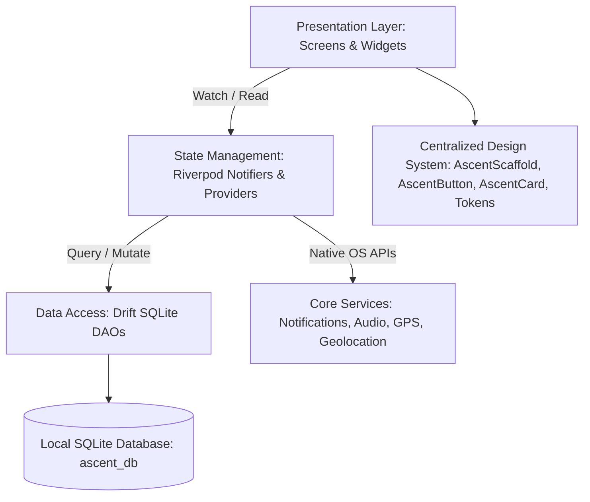

# Ascent — Application Architecture Specification

**Version:** 1.0  
**Target:** Pre-Release Production Standardization  
**Location:** `docs/APP_ARCHITECTURE.md`

---

## 1. Executive Architectural Overview

Ascent is architected as an **offline-first, zero-latency, on-device job prep and life companion**. The entire application operates without requiring continuous network connectivity, storing all user data (tasks, focus sessions, syllabus progress, DSA logs, job applications, financial transactions, resumes, self-talk thoughts, prescriptions, and water logs) in a local SQLite database powered by **Drift** and managed via **Riverpod**.



---

## 2. Current Architecture & Identified Problems

### 2.1 The Two Divergent Architectural Generations
Over the evolution of Ascent, the codebase transitioned from an initial Material 3 scaffold architecture to a custom "Liquid Glass" atmospheric design system. However, this transition was incomplete:
- **First-Class Screens (14):** Fully refactored to use `AscentScaffold`, `AscentGlass`, `AscentAtmosphereBackground`, and `AscentCard`.
- **Secondary Screens (11):** Left on legacy standard `Scaffold`, raw `AppBar`, and standard Material `Card`.

### 2.2 Dual Streak State Engines
Two independent streak tracking mechanisms exist:
1. `StudyStreakProvider` (`lib/core/streak/study_streak_provider.dart`): Calculates streaks based on daily study minutes, task completions, and active study phase rules.
2. `ConsistencyDao` (`lib/core/database/daos/consistency_dao.dart`): Calculates streaks based on rows in `ConsistencyLogTable`.
In `HomeHeader`, the UI performs a fallback (`final streak = studyStreak.displayStreakDays > 0 ? studyStreak.displayStreakDays : legacyStreak`), whereas `ConsistencyScreen` watches `ConsistencyDao` exclusively. This introduces a state drift risk where Home and Consistency screens display differing streak counts.

### 2.3 Unused Repository Abstraction Layer
`lib/core/repository/local/` defines 5 repository classes (`LocalTaskRepository`, `LocalApplicationRepository`, `LocalConsistencyRepository`, `LocalDsaRepository`, `LocalUserProfileRepository`). 
None of these repositories are used by any feature screen or test. Every feature injects and queries Drift DAOs directly via Riverpod providers (`taskDaoProvider`, `applicationDaoProvider`, etc.). This dead repository layer adds confusion and maintenance burden without providing real architectural abstraction.

### 2.4 Unused Third-Party Dependencies
`pubspec.yaml` imports `motor: ^1.1.0` (animation physics), `heroine: ^0.7.2` (hero animations), and `flutter_confetti: ^0.9.2`. None of these packages are imported or referenced anywhere in `lib/` or `test/`.

---

## 3. Proposed Streamlined Architecture

### 3.1 Principles
1. **Lightweight & Pragmatic:** Do not introduce heavy, ceremony-laden Clean Architecture layers (Entities -> DTOs -> Repositories -> UseCases -> Presenters) for simple CRUD operations.
2. **One Source of Truth:** Drift SQLite DAOs are the authoritative source of truth. Riverpod `StreamProvider` and `Notifier` expose observable state directly to UI widgets.
3. **Consistency by Default:** Shared widgets (`AscentScaffold`, `AscentCard`, `AscentButton`, `AscentTextField`, `AscentBottomSheet`, `AscentDialog`, `AscentSnackBar`) encapsulate design rules so developers cannot accidentally violate theme, radius, or spacing rules.

### 3.2 Target Directory Structure

```
lib/
├── app/
│   ├── app.dart                   # Root MaterialApp with theme & router bindings
│   ├── router.dart                # GoRouter route declarations & shell configuration
│   └── theme/
│       ├── app_theme.dart         # Light & Dark ThemeData builders
│       ├── color_tokens.dart      # Semantic color tokens & AscentColorsX
│       ├── dimension_tokens.dart  # Centralized radii, spacing, heights
│       ├── glass_theme.dart       # Liquid Glass theme extension & AscentGlassX
│       └── text_styles.dart       # Consolidated 3-font typography scale
├── core/
│   ├── ai/                        # On-device deterministic AI engine
│   ├── auth/                      # Local auth & profile state
│   ├── database/
│   │   ├── app_database.dart      # Drift database, schema version & migrations
│   │   ├── tables/                # SQLite table definitions
│   │   └── daos/                  # Type-safe SQL query DAOs
│   ├── notifications/             # Local notifications & scheduled nudges
│   ├── providers/                 # Core database & settings providers
│   ├── streak/                    # Single authoritative streak computation engine
│   ├── walk/                      # Background walking GPS service
│   ├── medicine/                  # Multi-day prescription scheduler
│   └── services/                  # Hydration reminder & background services
├── features/                      # Isolated domain features
│   ├── home/
│   ├── today/
│   ├── reminders/
│   ├── money/
│   ├── momentum/                  # Coming Soon screen (former code retired)
│   ├── chai_break/
│   ├── study_plan/
│   ├── thought_wall/
│   ├── pipeline/
│   ├── dsa/
│   ├── interview_prep/
│   ├── consistency/
│   ├── resume_vault/
│   ├── book_reader/
│   ├── analytics/
│   ├── ai_assistant/
│   ├── settings/
│   └── onboarding/
└── shared/
    └── widgets/                   # Standard reusable UI kit
        ├── ascent_scaffold.dart
        ├── ascent_button.dart
        ├── ascent_card.dart
        ├── ascent_text_field.dart
        ├── ascent_bottom_sheet.dart
        ├── ascent_dialog.dart
        ├── ascent_snack_bar.dart
        ├── ascent_atmosphere.dart
        ├── empty_state.dart
        ├── skeleton_shimmer.dart
        └── live_session_bar.dart
```

---

## 4. State Management Strategy & Data Flow

1. **Database Mutation:** User performs an action (e.g. completes task). The widget calls `ref.read(taskDaoProvider).updateTask(...)`.
2. **Reactive Stream Emission:** Drift watches the SQLite table via SQLite update hooks and automatically emits the updated list to `ref.watch(todayActivitiesProvider)`.
3. **UI Re-render:** Flutter rebuilds the affected widgets reactively in <16ms without manual polling or state synchronizers.
4. **Cascading Lifecycle:** When an entity is deleted, the DAO or service performs a clean cascading delete (canceling active notifications, stopping running timers, removing related records) to prevent orphan references.

---

## 5. Navigation & Lifecycle Architecture

- **GoRouter Configuration:** `ascentRouter` in `lib/app/router.dart`.
- **Root Navigator Key:** `rootNavigatorKey` ensures push notifications can deep-link into sheets or screens even when the app is suspended.
- **Back Button Protocol:**
  - Double-tap back within 2 seconds on Tab 0 (Home) exits the app (`SystemNavigator.pop()`).
  - Pressing back from any secondary tab (Reminders, Money, Momentum, More) navigates back to Tab 0 first.
  - Subpages opened via drawer or deep link have explicit liquid back buttons returning to the previous stack entry.
