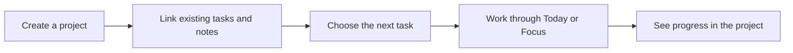

# Ascent next update — Your Home, Connected Projects

Planning draft · 12 October 2026  
Released baseline: **1.0.9 (10)** · Proposed next feature release: **1.1.0**, subject to release readiness.

This document specifies the next update. It does not change the released app or begin implementation.

## 1. Product direction

**A calm personal space to organize your day and make progress on what matters to you.**

Ascent supports studying, work, personal projects, health, everyday responsibilities, and career preparation. Career tools remain available as optional tools. Home should reflect the person's choices, rather than assume their occupation or ambition.

The update has two priorities, in this order:

1. **Home customization:** choose what appears, organize it, and keep the daily view calm.
2. **Connected projects:** bring existing tasks, notes, reminders, and focus time together around a purpose.

Success means existing features become easier to use together. The release should not become a collection of new modules.

## 2. What exists today

The current Home renders its main sections in a fixed order: header, onboarding/return guidance, optional study streak, upcoming reminder, Today, Learning, Life & Health, and Mind Space. The Life & Health section bundles challenge, medicine, hydration, and break tools. Streak visibility already has a separate toggle.

The data model already links reminders and focus sessions to tasks. Tasks also support subtasks, series, study phases, and career applications. Notes live in Thought Wall. Projects must build on these relationships and preserve the existing screens and completion rules.

Relevant starting points:

- `lib/features/home/home_screen.dart`
- `lib/features/home/widgets/quick_modules_nav_hub.dart`
- `lib/core/providers/settings_provider.dart`
- `lib/core/database/tables/task_table.dart`
- `lib/core/database/tables/reminder_table.dart`
- `lib/core/database/tables/thought_tables.dart`
- `lib/core/database/tables/time_session_table.dart`
- `lib/core/backup/workspace_backup_service.dart`

## 3. Phase A — Make Home yours

### Experience

A small **Customize Home** control in the header opens a glass bottom sheet. Home remains clean during everyday use; editing controls appear only in the customization flow.

The editor shows visible cards in their current order and a separate list of available cards. Each row has a short description, visibility switch, and reorder handle. Accessible **Move up / Move down** actions provide an alternative to dragging.

Changes are previewed in a compact Home layout above the list. **Save changes** applies them together; **Cancel** discards the draft. **Restore default layout** resets only Home preferences, with a confirmation. Saving provides a short glass confirmation.

### Controls included

| Home content | Proposed control | Behavior |
| --- | --- | --- |
| Today | Show/hide and reorder | Existing task board and Add activity remain accessible elsewhere |
| Learning | Show/hide and reorder | Course catalog, syllabus, and player remain reachable |
| Life & Health | Show/hide and reorder | Choose which existing tools appear inside the section |
| Mind Space | Show/hide and reorder | Notes and drafts remain intact |
| Upcoming reminder preview | Show/hide and reorder | Notifications and alarms remain enabled according to their own settings |
| Study streak | Show/hide and reorder | Existing visibility preference is migrated without resetting it |
| Quick shortcuts | Choose up to four existing destinations | Optional compact row; no new feature destinations required |
| Projects, when Phase B ships | Show/hide and reorder | Preview up to three pinned projects |

Header, profile/settings access, Customize Home, and the Riya gateway remain fixed and reachable. The existing live-session controls remain accessible even when their Home section is hidden. Pending restore/scheduling notices and real ringing-alarm controls cannot disappear because of customization.

**Hiding a card changes presentation only.** It does not delete records, stop a timer, pause tracking, or disable reminders. Explicit settings inside the relevant tool continue to own those behaviors.

### Life & Health choices

Allow hydration, medicine, walks, challenges, and breaks to be individually shown or hidden within the Home section. Reuse existing tool entry points and data; do not add several large standalone cards to the feed. Hide empty gaps and maintain direct navigation to every selected tool.

A hidden tool remains accessible through More. Its full screen keeps any existing logging or reminder controls.

### Defaults and optional starting layouts

- Existing users retain the current layout until they change it. Preserve the existing streak preference.
- New users receive a neutral, compact layout centered on Today, Mind Space, and existing everyday tools. Learning and career tools can be enabled immediately through customization or More.
- Optional **Everyday**, **Study**, and **Personal projects** starting layouts are shortcuts for arranging cards, not account types or permanent identities. The user can edit any layout afterward.
- Applying a starting layout changes only the editor draft until Save. Do not fabricate tasks, learning content, medicines, projects, or health records.
- If every optional card is hidden, show a calm empty state with **Customize Home** and **Open tools**. Do not silently turn cards back on.
- No automatic reordering or surprise cards after an app update. Newly available cards appear in the customization list until the user enables them.

### Visual treatment

Keep the atmospheric background, warm clay accent, shared glass surfaces, and readable theme ink. Selected controls use a soft fill and clear checkmark. Avoid dense outlined button grids and oversized customization banners.

Use short transitions and haptics during editing. Reordering should not leave permanent animated effects on Home. Respect reduced-motion settings and maintain light/dark consistency.

Cap previews: Today keeps its existing bounded preview; shortcuts max four; projects max three. Every preview has a clear destination for the full view.

## 4. Phase B — Connect work through projects

### The project model

A project is a lightweight purpose for existing work. Examples: **Finish my semester**, **Build my portfolio**, **Plan a family trip**, or **Prepare for interviews**.

Creation requires only a name. Optional fields: short purpose, accent/icon, and target date. A project does not require a career profile, daily target, streak, or timer.

The first release supports tasks and Thought Wall notes as direct project members. Task-linked reminders and focus sessions appear through their existing task relationships. It also supports attaching a standalone reminder directly to a project. Other tools continue to operate normally.

Each item belongs to at most one project in this release. An item can remain unassigned. Linking moves its association; it never duplicates the underlying record.

### Core flow

Projects are available through More and an optional Home preview. A project detail screen contains:

- Name, purpose, optional target date, and a clear project menu.
- A user-selected **Next task**, with Start focus only when that task supports a timer; ordinary to-dos offer completion and editing.
- Tasks, including completed items, using the existing task behavior.
- Linked notes, with their existing editing/archive actions.
- Upcoming reminders, identifying Notification or Alarm mode.
- Completed task count and recorded focus time, with direct links to their source items.

The layout prioritizes the next useful action. Details can expand without putting everything in the first viewport.

### Linking and everyday use

- Add an optional **Project** picker to task, note, and reminder creation/editing.
- Offer **Link existing items** from a project. Search and select real records; explain an existing association before moving it.
- Notes created in a project remain the same Thought Wall records and are visible there.
- Project tasks remain visible on their planned dates in Today. Projects add context rather than replace the task board.
- A linked task's reminder and focus history inherit its current project context. Changing the task's project changes where those records are displayed, without rewriting their times or creating copies.
- When a reminder links to a task, that task owns its project association; the reminder must not also point to a conflicting project.
- Standalone focus sessions remain in Focus. Directly assigning them to projects is deferred to keep the first version small.
- Subtasks inherit the parent task's project; they cannot silently belong to another project.
- Existing course, series, and application associations stay intact. Project links do not rename or replace those concepts.

### Progress that users can trust

Show **3 of 8 tasks completed** and **Recorded focus time: 2 h 15 min** separately. Include only recorded active time under the existing timer rules; do not count pauses or add the same session twice.

Project task counts use top-level tasks; subtasks remain visible within their parent. Project focus totals include qualifying sessions linked to those tasks and their subtasks once each.

A project with no tasks shows **No tasks yet**, rather than 100% complete. No automatic completion based only on a percentage. The user explicitly completes or reopens a project.

Do not blend health metrics, note count, study streak, and task completion into an unexplained score. Health tracking keeps its own meanings and rules.

### Lifecycle and recovery

| Action | Result |
| --- | --- |
| Unlink an item | Keep the record, completion state, reminders, and recorded time; remove only its project association |
| Archive a project | Hide it from active project views; keep its records accessible; existing reminders continue unless separately changed |
| Complete a project | Mark its status complete; explicitly explain any still-active reminders and offer a separate reminder-management action |
| Reopen a project | Return it to active status without undoing task completion |
| Delete a project | Confirm that the project is removed and its records become unassigned; preserve their existing schedules and history |
| Delete an individual task or reminder | Retain existing cleanup rules for dependent records and native alarms |

Deleting a project must not bulk-delete personal notes or tasks. No automatic cancellation of medicines, alarms, or running sessions because a project was archived or removed. Project updates must remain atomic and recoverable after interruption.

## 5. Riya and broader product language

In Phase A, use neutral default wording throughout the changed flows. Audit onboarding, More, empty states, and default profile labels for assumptions such as **Job Seeker**. Keep genuine career-specific labels inside the optional career tools.

In Phase B, extend Riya's existing actions with project context, rather than introduce a new chat experience:

- “Add review chapter four to Semester prep.”
- “Save this idea in My portfolio.”
- “What is next in My portfolio?”

Resolve real project names. Ask a short clarification if multiple projects match or the intended project does not exist. Do not silently create a project. Keep the existing verified-action receipt and correction/Undo behavior. Riya should not report a successful project change until it has actually been saved.

## 6. Implementation approach

### Home

Create a small registry of supported Home sections with stable IDs, labels, builders, and preview limits. Replace the hard-coded arrangement with a validated saved configuration. Avoid a general widget builder, arbitrary layouts, or resizable card canvas.

Store a versioned configuration in the existing settings layer. Persist visible sections, order, tool choices, and shortcut IDs together. Reject duplicate/unknown IDs safely; recover corrupted preferences to a usable default. Do not subscribe to hidden cards' presentation providers unnecessarily. Service-level reminder, recovery, and active-session behavior stays independent of card rendering.

### Projects

Add a dedicated project table with active/completed/archived status and relevant timestamps. Add nullable project associations to tasks, notes, and standalone reminders. Prefer explicit foreign keys and deletion behavior over title matching or loosely typed metadata. Derive linked reminder/session context through tasks.

Use the existing DAOs/providers and existing item screens for edits. Project queries should stay bounded for Home previews and load full content in project detail. Keep joins and aggregates off the main rendering path where practical.

Migration from the released schema must preserve all existing IDs, relationships, notification modes, timestamps, and completion state. Existing records start unassigned; do not infer projects from titles or career fields.

### Backup compatibility

Include Home configuration and projects in export/restore. The current backup importer handles a specific older schema transition; a new project schema needs an explicit compatible migration for supported 1.0.9 backups. Unsupported formats must fail without altering the workspace.

Restore must preserve project associations and Home choices, reconcile device alerts through the existing recovery flow, and leave imported live sessions paused under existing rules. Missing or removed Home-section IDs must not break restored layouts.

## 7. Delivery sequence and scope gates

| Stage | Deliverable | Ready when |
| --- | --- | --- |
| 1. UX specification | Home editor and project-detail mockups in both themes | Normal, empty, saved, cancelled, large-text, and error states are reviewable |
| 2. Home foundation | Section registry and preference persistence | Existing users retain their layout; hiding/reordering survives restart and restore |
| 3. Home experience | Glass editor, tool choices, shortcuts, neutral wording | All tools remain reachable; reminders and live sessions remain safe |
| 4. Home beta checkpoint | Installable build and short user feedback round | Users can customize without explanation, accidental data changes, or lost navigation |
| 5. Project foundation | Schema, associations, migration, backup handling | Linking, unlinking, deletion, and recovery pass meaningful data tests |
| 6. Project experience | Project list/detail, item pickers, optional Home preview | The same record behaves consistently in Today, Focus, Thought Wall, and Projects |
| 7. Riya integration and release | Verified project-aware actions, final APK, release notes | Ambiguity/failure handling, regression checks, and device validation pass |

Phase A can ship independently if beta feedback calls for more iteration before projects. Prefer a complete smaller release over rushing both halves. Version and dates are decided when the scope is ready; this plan makes no delivery-date promise.

### Explicitly deferred

Weekly review, new habit/routine engines, shared/team projects, cloud sync, calendar integrations, job listings, project budgets, AI-generated progress scores, dependencies/Gantt charts, course-to-project conversion, multiple projects per item, and a new bottom-navigation structure.

Existing money, medicine, learning, walking, and career tools stay available. Their broader project linking can follow only after the core connection model proves useful.

## 8. Acceptance and beta checks

Before implementation, write meaningful tests for changed behavior and data lifecycles. Continue using the released 1.0.9 UI as the visual baseline.

### Home acceptance

- An existing user upgrades with the same card order, records, and streak preference.
- A user saves a reordered layout, restarts, and sees the same arrangement.
- Cancel leaves Home unchanged; resetting affects only Home settings.
- A user hides Learning or Medicine and can still open it through More.
- Hidden reminders still fire; a hidden Focus section does not orphan a running session.
- Choosing Life & Health tools does not alter their logs or schedules.
- All-hidden, empty-data, corrupted-preference, and unknown-section states remain usable.
- Light/dark mode, 2× text, keyboard, screen-reader actions, and reduced motion are verified.
- Measure Home rendering and scrolling against the released build on the same device. Maintain the existing performance target and investigate any regression; do not claim a timing result without measurement.

### Projects acceptance

- One task or note linked from a project remains the same editable record in its original tool.
- Linking/moving/unlinking never duplicates data or loses existing associations.
- Task/subtask inheritance and reminder ownership cannot create conflicting projects.
- Focus totals exclude pauses and count each qualifying session once.
- Empty projects do not show fabricated progress; project completion does not imply that unrelated work is done.
- Archive/delete preserves items and their schedules as documented; item deletion retains native-alarm cleanup.
- Migration and export/restore round trips preserve projects, relationships, Home preferences, and active reminder modes.
- Riya handles ambiguous names, retries, failed saves, and duplicate submissions without false success or duplicate writes.

### Beta-user prompts

1. Can you make Home useful for your own day in under a minute?
2. Can you find a tool after hiding its Home card?
3. Can you connect a task and a note to a project without recreating them?
4. Can you tell what to do next and how progress was counted?
5. Does Ascent feel useful beyond career preparation?

Record completion difficulties, accidental changes, crashes, confusing labels, and user comments. Use that evidence to refine the update before expanding scope.

## 9. First implementation task

Start with **Home customization UX mockups and the section registry specification**. Validate the editing flow and default behavior before changing the database or implementing projects. Keep this document updated as beta evidence changes the decisions.
