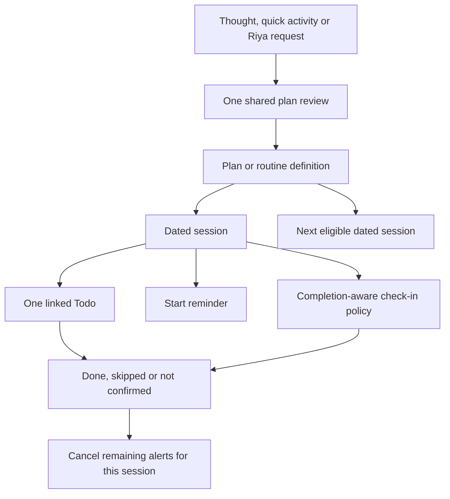

# Plans and routines: experience, audit and implementation proposal

**17 October 2026 · Proposal for review; recurring plans are not implemented by this document.**

## 1. The experience we should build

A user describes something they want to do, chooses when it should happen and how long the routine should continue, then approves one clear summary. Ascent creates the dated activities and connects their reminders and check-ins. The user never needs to maintain three separate lists.

Example:

> Walk every morning at 7 for 30 minutes until 31 October. Remind me and keep asking whether I did it.

The review should resolve ambiguous details, then read:

> **Morning walk**
> Every day · 7:00 am · 18–31 Oct 2026
> Add to Today · Remind at 7:00 am
> Ask at 7:40 am; if unanswered, again at 8:10 and 9:10 am
> **Create routine**

That is 14 dated sessions, each with its own completion status. Finishing Sunday does not finish Monday. “Until 31 October” includes sessions starting on that date; no new session starts on 1 November.

I am treating “until the selected time” as two separate choices: **the time of each session** and **the last date of the routine**. A single future task remains a one-time plan. We should not force repetition onto every plan.

The product promise is: **describe once, review once, receive the right activity and follow-up at the right time, and change it from one place.** Reliability means explicit ownership, recoverable saves and predictable state changes; it cannot mean promising notification delivery when the phone has blocked it.

## 2. Audit of the current implementation

The current system is a useful one-time foundation. These are findings from the current source, rather than assumptions about a future feature.

| Area | What exists | Implication |
|---|---|---|
| Home thought capture | Send saves a thought and exposes Plan/Todo/Reminder actions. It deliberately does not open a planning sheet automatically. | Keep the quiet capture path. An ordinary reflection must stay a reflection. |
| Plan review | Make a plan edits title, reminder time, optional linked Todo and optional check-in. Its footer explicitly says it is one-time. | Reuse a shared review flow, adding repetition through progressive disclosure. |
| Interpretation | Local parsing recognizes today/tomorrow/ISO dates, am/pm clocks, some action verbs, duration and follow-up wording. | It is not a recurring-schedule parser. “Every weekday”, a repeat end date, exceptions and many natural-language expressions need new validation or clarification. |
| Persistence | HomeCaptureService commits a task, reminder, optional check-in, thought links and a command receipt together. A source thought has a stable home.schedule request key. | Preserve transactions and retry protection. A source thought/request key is not a recurring occurrence identity. |
| Check-in answers | Done/Later/Skip compare the reminder ID and scheduled occurrence time. Later moves the check-in; Skip leaves the Todo unfinished. | Preserve stale-action protection. Introduce separate names for dismissing a question and skipping the activity. |
| Completion | Existing task/focus rules protect timed tasks and learning activities; completion cancels linked reminders. | A recurring check-in must use these rules, not directly set completed flags. |
| Home presentation | Up next shows up to four active plans. Home excludes linked plan tasks/reminders from other Home sections to prevent duplicate rows. | Routine sessions should appear once inside Today. Hiding the task behind Up next makes the Todo connection less obvious. |
| Repeated reminders | Reminders supports 7 days, 30 days, weekdays and monthly choices by inserting separate dated reminder rows. | This is batch creation, not a managed routine with shared pause, edit, end-date or per-session completion. |
| Reminder data | Reminders link to tasks, but have no routine/occurrence/attempt ownership fields. | Add explicit relationships. Never infer ownership from a matching title. |
| Drafts | One SharedPreferences key stores the pending Home schedule. | Multiple independent plan drafts need independent identities; one draft should not overwrite another. |
| Assistant entry | Riya can use the shared Home schedule review for a planning request. | Extend the same coordinator; avoid separate assistant and native scheduling engines. |
| Notification responses | Current check-in actions route an answer to Home. | Do not assume they already perform headless background database writes. Test cold launch and platform action behavior explicitly. |
| Alerts | Pending sync is durable, retries exist, notification destinations are validated, and scheduling uses local timezone conversion. | Reuse these strengths, but add occurrence-aware queue replenishment, expiry and version checks for routines. |
| Activity conversion | The new quick-entry/editor service retains identity/history and protects live timers, completed work and lectures. Home managed-plan schedule changes use plan controls. | Future routine edits must preserve these constraints and distinguish one session from the entire routine. |

Current one-time tests cover duplicate approval, stale drafts/actions, completion cancellation, Later/Skip semantics, rescheduling, timer completion restrictions, notification routing and backup restoration. The last full app run passed 550 tests. That evidence supports the existing foundation; it does not certify recurring behavior that has not been built.

### What I would change first

1. Make it impossible to silently treat a repeating request as a one-time plan. If recurrence language is detected but not understood, keep a draft and ask one focused question.
2. Use one dated activity row in Today, with its reminder/check-in state attached.
3. Replace ambiguous “Skip” language with “Skip check-in” and “Skip this time”.
4. Give plans a shared owner and each session its own identity before adding repeated notifications.
5. Add clear pause/end/edit scope and a tested background delivery strategy before exposing an open-ended routine.

## 3. One definition, many dated sessions

A **plan** describes the intended activity and its schedule. A **routine** is a plan that repeats. A **session** is one dated occurrence of that plan.

Each session owns at most one linked Todo, its start reminder and its check-in attempts. The routine owns the repetition rule and future sessions. This avoids one giant Todo that gets reopened every day, unrelated daily copies and several records claiming to represent the same work.



The source thought belongs to the definition. We should not link every session task to the same thought using the current one-task completion cascade: completing the first day could otherwise mark the source thought finished while the routine is still active. Keep the original capture and its routine association separate from daily completion.

## 4. Where the feature should be exposed

| Surface | Entry or presentation | Scope |
|---|---|---|
| Home thought capture | Persistent Plan action on the saved thought; an optional compact planning suggestion when the text contains clear schedule intent | Create a one-time plan or routine without changing ordinary Send into a forced form |
| Home activity input | Keep current To-do/Today/Reminder off defaults. Offer Repeat in secondary options or a post-save action | Promote the existing activity into a plan; do not create another task or require another thought |
| Riya | Requests such as “Plan a weekday reading routine” open the same reviewed draft; later requests can refer to a selected routine | Interpret and explain; scheduling and completion stay deterministic |
| Today card | One row for each eligible session today, including start time and any due check-in controls | Act on this session only |
| Thought detail | Show “Linked routine” and an Open plan action | Review the source and manage its definition |
| Activity detail/pencil | “Make repeating” for an eligible standalone activity; “This session / Routine” for a routine-owned task | Avoid confusing a local edit with a series edit |
| Reminders | Group routine alerts under the routine/session and link to its details | Inspect delivery and edit the correct owner rather than a raw child reminder |
| Plans view | Accessible from Today’s overflow and a Reminders “Plans” entry, with Active/Paused/Ended views | Manage entire routines and inspect future sessions/history |
| Notifications | Reminder opens the session; check-in offers Done, Later and Skip this time | Fast occurrence-specific actions with stale-action checks |
| Settings | Quiet hours and notification troubleshooting | Delivery preferences; not the primary place to create routines |

**Do not add a new permanent bottom-navigation item for the first release.** Home remains fast to type into. The Plans view can become a first-class tab only if actual usage warrants it.

Existing “View board” still opens Today’s board. A separate quiet Plans entry belongs in overflow, not another large Home hero. “Up next” should become a compact future-session preview; it must not repeat a session already shown in Today. Due check-ins belong to their activity row, not another duplicate task card.

## 5. Creation: a small review, not a questionnaire

The first screen should show the activity title and a plain-language schedule sentence. Tappable values expand only the options being changed.

```text
Make a plan
Morning walk

Every day · 7:00 am · Until 31 Oct
Add to Today                 On
Remind me                    7:00 am
Ask afterwards               Gentle

[Create routine]
```

Secondary controls contain start date, expected duration, timer tracking, custom weekdays, timezone policy, sound/alarm and follow-up limits. Do not display all of them at once.

Rules for defaults:

- Thought Send still saves a thought. Activity Send still creates a To-do today with reminders off.
- Plan review defaults to Once unless repetition is explicitly requested or selected.
- Add to Today defaults on for an actionable plan. Reminder-only plans remain possible without inventing a task.
- Reminders and follow-ups turn on when the user explicitly requests/selects them, and the summary must show this before approval.
- An expected duration helps calculate a check-in time. It does not silently convert a Todo into a tracked Timer or start one.
- A timer is a deliberate type choice; start/pause/finish remains under the existing timer controls.
- If the end date is missing for the first finite-routine release, ask “Until when?” with “For 7 days”, “For 30 days” and “Pick date”. Never silently end a supposedly indefinite routine after a week.
- If “at 7” lacks am/pm, ask “7 am or 7 pm?” rather than guess.
- Show the full resolved dates in the final preview, with timezone when it matters. A short sentence is enough on Home.

When an existing activity becomes a routine, reuse it as the first session only when its date/state fits the reviewed schedule. Otherwise, keep that original task and start the routine at the reviewed next session; make that distinction visible. A completed activity may be used as a template for a new future routine, but its historical task must never be reopened.

The review saves once. Cancelling it preserves the draft/source but creates no active routine. Return to the right draft later; make “Keep as thought” or “Discard plan draft” explicit.

## 6. Daily use, step by step

For the 7 am walking example:

1. Before the scheduled day, Plans shows the upcoming session. Today is not filled with fourteen future walking tasks.
2. On 18 October, Today shows “Morning walk · 7:00 am”. It is the same task record that the reminder references.
3. At 7 am, an enabled start reminder appears. Opening it focuses that session.
4. If the user completes the task before 7:40, all remaining check-ins for that session are cancelled. No “Did you do it?” follows an already completed activity.
5. Otherwise, at 7:40, ask “Did you finish your morning walk?” The same question is available on the Home activity row.
6. Done completes only 18 October’s activity through its normal completion rules. Tomorrow’s activity remains scheduled.
7. Later lets the user choose a follow-up delay; it does not silently move the whole routine.
8. Skip this time closes only today’s session as skipped and cancels its remaining alerts. It does not mark the work done or cancel tomorrow.
9. If unanswered, the reviewed gentle policy may ask at 8:10 and 9:10. After its cutoff it stops asking. The state is “Not confirmed”, not an assertion that the user did nothing.
10. On 19 October, the next dated session appears independently.

A check-in notification never starts a timer automatically. For a tracked activity, “Done” must verify existing completion requirements or offer “Open timer”; it cannot award an unfinished timer’s completion.

## 7. Asking like an assistant, without becoming noisy

There are three different preferences:

| Preference | Meaning |
|---|---|
| Ask afterwards: Off | Start reminder only, if enabled |
| Ask afterwards: Once | One question after each scheduled session |
| Ask afterwards: Gentle | One question plus at most two automatic retries if unanswered |

For a request that explicitly says “keep asking”, propose Gentle in the review. Otherwise, use Once when follow-up is requested. The sample Gentle timing is first check-in, then +30 minutes and +90 minutes from that first check-in; show the actual times and stopping point before saving.

“Later” is an explicit user-requested reschedule of the next question. It should replace that pending question, not stack an extra notification on top. Cancel or recalculate **all remaining questions** when Later is chosen, so an old automatic retry cannot interrupt before the chosen new time. Keep the automatic-attempt counter; Later must not reset it and create an endless retry loop. An explicitly requested later question can be scheduled within the valid window without enabling a fresh automatic series.

Later must remain within the session’s valid response window and before the next session. If it would cross that boundary, offer “Skip this time” or “Move this session” instead.

Set an explicit per-session automatic-attempt budget, a response cutoff and a global interruption budget. Do not schedule unbounded repeats. Respect configured quiet hours; collapse simultaneous questions into a single “2 activities need a check-in” notification rather than firing a burst. The user still answers each activity separately in the app. Completing one grouped activity refreshes the summary and retains the other activities’ pending questions.

Pausing a routine must be easy from its detail page. Ignoring one question must not be interpreted as consent to escalate its tone or frequency.

Riya-style wording can use short local templates. The daily scheduling loop, retry policy and Done/Later/Skip actions must work offline without an AI model call. Use an AI model only when it helps interpret or discuss a request, not for every alarm tick. This also avoids recurring model-credit costs for ordinary routines.

## 8. Name the actions precisely

| Action | Effect on current activity | Effect on current alerts | Effect on future routine |
|---|---|---|---|
| Done | Completes through existing rules | Cancel remaining alerts for this session | None |
| Later | Remains unfinished | Replace next check-in within the valid window | None |
| Move this session | Reschedule this occurrence with a clear date/time | Recalculate this session’s alerts | None |
| Skip check-in | Remains unfinished | Stop its remaining questions; preserve a future start reminder | None |
| Skip this time | Mark this occurrence skipped, without completion credit | Cancel all remaining alerts for it | None |
| Pause routine | Keep history; stop scheduled activity/alert generation while paused | Cancel pending routine alerts | Resume only by explicit action |
| End routine | Keep history and unanswered outcomes | Cancel pending alerts | No new sessions |
| Change routine | Keep already resolved sessions unchanged | Replace alerts only for affected future sessions | Apply reviewed new definition/version |

Pause/end of a schedule must not silently discard an actively running timer. Make that distinction clear and offer its existing timer controls. A daily occurrence needs a meaningful closing window; cross-midnight work and check-ins are allowed only if they fit before the next occurrence. Compute that window explicitly, and reject overlapping or impossible schedules in the review.

### Protected removal of plan-owned To-dos and reminders

A plan-owned task or reminder must not be independently hard-deleted through ordinary Delete, swipe-to-delete, bulk selection or an assistant command. Its owner and occurrence determine the allowed operation. Show a small **“Part of Morning walk”** link to the plan so the restriction is understandable, and offer a useful replacement action rather than a dead-end error.

| Attempted action | Replacement offered | Required result |
|---|---|---|
| Delete a routine-created To-do | **Skip this session** or **Open routine** | Preserve task/occurrence identity and logged history; mark only this session skipped, hide it from unfinished lists and cancel its pending alerts. Future sessions remain active. |
| Delete its start reminder | **Turn off reminder for this session** | Keep the activity and routine; cancel only the start reminder. Keep separately enabled check-ins unless the user also stops them. |
| Delete its check-in reminder | **Stop asking for this session** | Keep the To-do unfinished and the routine active; cancel every remaining check-in attempt for that session. Preserve an enabled start reminder. |
| Remove all future sessions or alerts | **Pause routine** or **End routine** | Apply one owner-level transaction, retain history and durably cancel the affected pending alerts. |
| Delete a task/reminder belonging to a one-time managed plan | **Skip this plan**, **Turn off reminder**, or **Open plan**, according to the child’s role | Apply the same ownership protection; there is no future repeating series to change. |
| Delete a standalone To-do/reminder | Existing Delete action | Preserve normal standalone deletion behavior. |

These are semantic changes to existing records, not delete-and-recreate operations. Disabling a start reminder is different from stopping questions, and both are different from skipping the work. None awards completion credit. If a live timer prevents skipping a session safely, route to its timer controls; never discard elapsed time silently.

Apply the rule across Home, Today’s board, task details/editor, Reminders, Riya, notification actions and bulk operations. A swipe on a protected row opens its scoped actions instead of deleting immediately. Riya clarifies “today’s session or the whole routine?” when the request is ambiguous; it must not infer End routine from “remove this reminder”. Bulk operations identify protected items and require an explicit supported scope instead of partially deleting linked records.

Enforce ownership in the shared services and DAO deletion paths, not just the UI. An ordinary deletion request for a protected child returns a structured restriction with its plan/occurrence ID and allowed actions, without changing records. Owner-aware operations validate the current occurrence/version, commit its outcome or alert policy plus pending cancellations atomically, and reject stale/repeated actions safely. Keep database relationships protected against accidental parent/child cascades; migration, explicit owner cleanup and whole-workspace replacement use narrowly scoped internal paths rather than a general-purpose bypass.

For device cancellations, retain the reminder ID and durable pending state until synchronization succeeds. A native cancellation failure must not resurrect the session or create a new reminder. If another screen completes or skips the session while its removal menu is open, re-read state and reject an obsolete action rather than overwrite the newer outcome.

## 9. What Today, Plans and Reminders should look like

**Today:** one compact activity row, a short date/time hint, progress if timed, and its normal completion/play action. When awaiting an answer, reveal “Done / Later / Skip this time” inside that row. Long titles truncate; details and the full schedule stay in the detail sheet.

**Plans:** small routine rows such as “Morning walk · Daily, 7 am · Until 31 Oct”. Detail shows the next session, schedule, reminder/check-in settings, pause/end actions and history. Completion statistics count due sessions and distinguish Done, Skipped and Not confirmed; future sessions are not failed attempts.

**Reminders:** a routine/session group can show the start reminder and next check-in when expanded. Do not show three retries as three unrelated chores. Editing a grouped alert opens its owner’s controls. Standalone reminders keep their normal workflow.

**Source thought:** one preserved note with “Routine active” and an Open plan link. Do not insert a new diary entry for every generated session or every clarification answer.

**Status text:** use “Saved”, “Alerts scheduled”, “Notifications off”, “Alert retry needed”, “Paused” and “Ended” precisely. A saved database plan is not proof that its phone notification has been scheduled successfully.

## 10. Recurrence and edit rules

First release: Once, Every day, Weekdays and selected weekdays. Start date and inclusive end date are explicit. Monthly schedules can follow after the existing bills/reminder behavior is reconciled with the shared owner model; decide whether unavailable month dates use the last day or skip, and show that rule.

Routine edits default to **future sessions**, with a clear effective date. Editing a visible session offers “This time” or “From the next session”. Do not rewrite resolved history.

- Change the time: replace affected future schedules and invalidate stale notification actions.
- Change weekdays/end date: add/remove eligible future sessions without duplicating existing dates.
- Extend the end date: append eligible future sessions.
- Shorten it: cancel sessions beyond the new end, retaining historical outcomes.
- Resume after a pause: show the next eligible session. Do not backfill every paused day into Today.
- Skip a holiday: change that occurrence, not the entire definition.
- Change To-do/Timer/Flexible: reuse existing conversion constraints. Definition changes affect future sessions; live sessions must not be converted underneath an active timer.
- Set a new timer target: it must exceed time already logged for that session. Never erase its history to make the conversion succeed.
- Complete a session from a different screen: update its plan outcome and cancel its pending questions as well.

At the end date, the routine becomes Ended when its final session window closes. Do not describe it as “completed successfully” solely because the calendar ended. Its history may contain completed, skipped and unconfirmed sessions.

## 11. Data and service design

A proposed additive model:

| Record | Responsibility |
|---|---|
| Plan definition | ID, source reference, title, activity type/target, expected duration, start/end dates, recurrence rule, local time, timezone policy, reminder/check-in policy, active/paused/ended state and revision |
| Plan occurrence | Stable ID, plan ID, eligible calendar slot, definition revision/snapshot, scheduled start/end/close time, linked task ID where applicable, outcome and answered/completed timestamps |
| Occurrence alert link | Explicit reminder ID, occurrence ID, role (start/check-in), attempt index and expected version |
| Plan draft | Draft ID/source/context, structured proposal and unresolved fields; not an active task |
| Operation receipt / pending effects | Retry identity and durable device scheduling/cancellation state |

A unique key such as `(planId, eligibleLocalDate, slotIndex)` prevents duplicate sessions. A task/reminder title is never a key. Definition revisions and notification tokens identify the exact occurrence/version/attempt being answered.

Use an explicit recurrence engine for eligible calendar dates, an occurrence materializer for linked records, a session-resolution service for answers, and a notification coordinator for device effects. UI screens call those services rather than inserting or mutating independent Todo/reminder copies.

For a finite routine, materialize its bounded logical sessions in the database so they can be viewed or resolved even if the app is not reopened between days. Keep the daily UI filtered to eligible sessions. A future open-ended routine may use bounded materialization, but it requires reliable extension before the horizon ends.

Saving commits the definition, occurrences, linked tasks/reminders, ownership links and pending effects atomically. Device scheduling happens after commit. If scheduling fails, report the pending state without repeating task creation. Answering commits the outcome plus durable alert cancellations atomically. Repeated or stale actions are harmless.

Existing command receipts should remain operation history. Do not treat their original arguments as the current editable routine definition. Existing one-time schedules can be adapted to a one-occurrence plan while retaining IDs and current links.

Queries in Today/Reminders must respect occurrence outcomes. A skipped, paused or cancelled routine session must not reappear as an ordinary unfinished Todo just because its task row has no completed timestamp.

## 12. Delivery when the app is closed

This is a release requirement, not a detail to postpone.

- Database occurrences and notification delivery are separate layers. Creating daily rows is insufficient if their alarms are never registered.
- Keep a bounded device queue, prioritize the earliest relevant alerts and account for existing standalone/medicine alerts. Derive queue limits from the chosen platform adapter and verified device behavior; do not assume unlimited pending notifications.
- Reconcile on launch/resume, plan edits, answers, permission changes, reboot/time changes where supported, and a tested native background mechanism. A Flutter UI timer cannot be the recurrence engine.
- Test a routine across the delivery horizon without reopening the app. If replenishment is unavailable or unproven, activate only finite schedules whose complete alert span fits the verified queue. Do not advertise open-ended delivery in that configuration.
- Open-ended routines should be a later capability until background extension, queue limits and recovery are proven. Never silently stop after the pre-scheduled days.
- Capture due dates by calendar rule in a named timezone, then resolve native instants. Do not implement daily recurrence solely by adding a fixed 24-hour duration.
- Recommend “Follow device local time” for ordinary daily routines, with “Keep original timezone” in advanced controls. On timezone changes, recompute unresolved future alerts and never re-issue an already resolved local-date session.
- Handle daylight-saving gaps/folds deterministically, show any adjusted time and generate only one occurrence for a calendar slot. Asia/Kolkata examples still need a timezone identity, rather than an assumption that every user/device has the same zone.
- Treat permission denial, platform restrictions and force-stop behavior honestly. Preserve the plan, show its alert status and provide repair; do not claim delivered alerts from a successful database write.

Reminder sound/alarm is separate from “Remind me”. Keep a loud alarm off unless explicitly selected. Routine check-ins must not also activate the legacy generic follow-up path, or the app can ask twice through two different systems.

## 13. Offline, recovery and migration

Routine execution and response handling must work offline. AI interpretation is optional; date/time controls always provide a local fallback. Notification actions must resolve the same occurrence whether the app is already open, cold-launched or responding through a supported background path.

On recovery, reconcile authoritative state before scheduling: completed/skipped/paused/expired sessions must not get fresh alerts. Do not blast all missed questions after a week away; show a small “3 sessions not confirmed” history summary and continue from the next eligible session.

Add new tables/links through the existing database migration and backup paths. Test backup restoration of definition revisions, outcomes and pending cancellations, not just task titles. Old notification actions must become stale after restoring or replacing a workspace.

Deleting or archiving a source thought does not end an independently approved routine. Keep a source snapshot and surviving plan identity, and state “Thought removed; routine is still active” when applicable. Only the routine’s Pause/End controls stop its future sessions. The protected-removal policy in section 8 governs task/reminder deletion attempts; source-thought removal never bypasses it.

Do not automatically infer routine groups from old repeated reminder titles. There is no shared owner in those legacy rows. Offer an explicit, reviewed conversion if needed, retaining unrelated reminders. Current one-time plans must continue working throughout rollout.

## 14. Acceptance scenarios before implementation is considered complete

These are future routine tests and acceptance gates, not claims that the recurring feature already passes them.

| Area | Required cases |
|---|---|
| Entry | Home thought → Plan; existing activity → repeat without duplication; Riya → same review; source thought remains available |
| Interpretation | Today/tomorrow, explicit dates, weekdays, end dates, missing am/pm, missing repeat end, unsupported language and ordinary reflections |
| Approval | Cancel creates no active plan; resume draft; multiple drafts; rapid double approval; interrupted save and retry |
| Calendar | Daily/weekday/custom-day patterns; start inclusive/end inclusive; leap day; month/year boundary; device timezone changes; daylight-saving gap/fold; cross-midnight session |
| Default behavior | Normal quick activity stays To-do/Today/Reminder off; duration does not automatically start or enable a timer |
| Ownership | One task per occurrence; explicit reminder links; same-title different plans independent; one source thought not completed by the first repeated session; source removal preserves an approved routine |
| Protected task removal | Delete/swipe from Home, board, detail and editor offers Skip this session/Open routine; no hard deletion; current alerts cancelled; future sessions and history retained |
| Protected reminder removal | Start-reminder removal keeps task/check-ins; check-in removal stops all remaining questions but keeps task/start reminder; no completion credit |
| Assistant/bulk removal | Riya uses owner-aware actions and clarifies scope; bulk selections cannot silently bypass ownership or partially delete a plan |
| Deletion enforcement | Direct DAO deletion of protected children rejected; standalone deletion still works; one-time managed plans also protected; accidental cascades blocked |
| Removal races/recovery | Stale menu after completion/skip/edit; repeated swipe/action; transaction failure; failed native cancellation and retry; no resurrection after restore |
| Reminder delivery | Reminder off; permission denied; exact delivery unavailable; scheduling failure; durable retry; cancellation failure and retry |
| Closed app | Delivery and queue extension without reopening; cold action; reboot/time changes; horizon exhaustion reported rather than hidden |
| Early completion | Done before first check-in cancels every remaining attempt; completion from Today/board/detail does the same |
| Check-ins | Once/Gentle; no response; maximum attempts; quiet hours; simultaneous questions grouped; no negative completion inference |
| Later | 15/30/60-minute choices; replacement and cancellation of old pending retries; no attempt-counter reset; near cutoff; near next occurrence; repeated/stale tap |
| Skip meanings | Skip check-in leaves task unfinished; Skip this time closes only this occurrence; neither completes tomorrow |
| Timers | To-do/Timer/Flexible conversions; running/paused restrictions; logged time retained; target above logged duration; no timer/lecture completion bypass |
| Edit scope | This occurrence versus future definition; time/day/type changes; extend/shorten end; history preserved; stale action rejected after edit |
| Pause/resume/end | Stops pending alerts; no backlog creation; next eligible date preview; current timer not discarded silently; ended plan history remains |
| Existing integrations | Parent/subtask completion checks; thought links; existing learning, walking and medicine flows remain intact |
| Migration/backup | Existing one-time plans retained; legacy reminders not grouped by title; occurrence links/versions restored; old workspace notifications rejected |
| Presentation | One Today row; no duplicate Up next task; grouped Reminders; long titles; keyboard; screen reader labels; 320px and 2× text; day/night contrast |
| Cost/offline | Scheduled operation and responses require no model calls; local controls work without a network |

## 15. Implementation sequence and review gates

1. **Unify the one-time experience.** Shared review/draft identity, precise skip labels, one Today row and a Plan detail owner. Preserve current transactions, IDs and completion behavior.
2. **Add finite recurrence in the data layer.** Definitions, occurrences, ownership, calendar rules, migrations and backup compatibility. Write calendar, identity and transaction tests before exposing Repeat.
3. **Complete delivery and response handling.** Native scheduling queue, bounded attempt policy, cancellations, stale tokens and background/closed-app recovery. Test on the actual phone; a green widget suite is not delivery verification.
4. **Expose the compact controls.** Repeat entry from Home/activity/Riya, shared sentence-style review, routine details and grouped reminders. Validate with a realistic multi-day routine rather than a dense demo dashboard.
5. **Add management.** This-time/future edits, pause/resume/end, exceptions, protected child removal across UI/assistant/DAO paths and honest history. Test all lifecycle transitions and the existing full app suite.
6. **Expand only after reliability holds.** Open-ended routines, monthly/custom patterns and explicit links to walking/learning/other modules. Do not guess module ownership from a title such as “walk” or “medicine”.

The most important first implementation is a **single smooth one-time path plus finite routines with a verified delivery strategy**. More schedule choices should not precede reliable ownership and response handling.

## 16. Recommended decisions

- Keep **Plan** as the action and **Routine** as the repeating subtype.
- Keep Home’s text-first design; do not add another large assistant card or mandatory questionnaire.
- Put the current session in **Today**, and manage repetition in **Plans**.
- Offer **Once / Daily / Weekdays / Pick days** first, with a reviewed finite end date.
- Populate reminders/check-ins from explicit intent; make their actual times and limits visible before saving.
- Offer **Once** for ordinary follow-up and **Gentle** for an explicit “keep asking” request, with bounded retries.
- Make completion, delay, skipping a question, skipping a session and pausing a routine distinct actions.
- Use local deterministic execution; Riya assists interpretation and conversation rather than paying for every nudge.
- Protect plan-owned To-dos/reminders from independent hard deletion; offer session-level Skip/Disable and routine-level Pause/End instead.
- Treat delivery, migrations, duplicate suppression and stale actions as product requirements.

## Source inspected

- [Home capture and one-time Plan service](/home/arunsinghvisen/Ascent-Beta/lib/core/services/home_capture_service.dart)
- [Plan review and pending draft](/home/arunsinghvisen/Ascent-Beta/lib/features/home/widgets/home_schedule_sheet.dart)
- [Up next and check-in response UI](/home/arunsinghvisen/Ascent-Beta/lib/features/home/widgets/home_up_next.dart)
- [Home section filtering](/home/arunsinghvisen/Ascent-Beta/lib/features/home/home_screen.dart)
- [Thought capture and Plan entry](/home/arunsinghvisen/Ascent-Beta/lib/features/home/widgets/thought_wall_home_preview.dart)
- [Riya shared scheduling entry](/home/arunsinghvisen/Ascent-Beta/lib/features/ai_assistant/ai_assistant_screen.dart)
- [Existing repeated-reminder creation](/home/arunsinghvisen/Ascent-Beta/lib/features/reminders/reminders_screen.dart)
- [Notification delivery](/home/arunsinghvisen/Ascent-Beta/lib/core/notifications/notification_service.dart)
- [Durable alert synchronization](/home/arunsinghvisen/Ascent-Beta/lib/core/notifications/reminder_alert_sync.dart)
- [Quick activity persistence and managed-plan constraints](/home/arunsinghvisen/Ascent-Beta/lib/core/services/activity_entry_service.dart)
- [Task type and completion rules](/home/arunsinghvisen/Ascent-Beta/lib/core/database/daos/task_dao.dart)
- [Existing one-time Plan tests](/home/arunsinghvisen/Ascent-Beta/test/home_capture_service_test.dart)
- [Existing capture review tests](/home/arunsinghvisen/Ascent-Beta/test/home_capture_flow_test.dart)
- [Existing notification check-in tests](/home/arunsinghvisen/Ascent-Beta/test/home_checkin_notification_test.dart)
